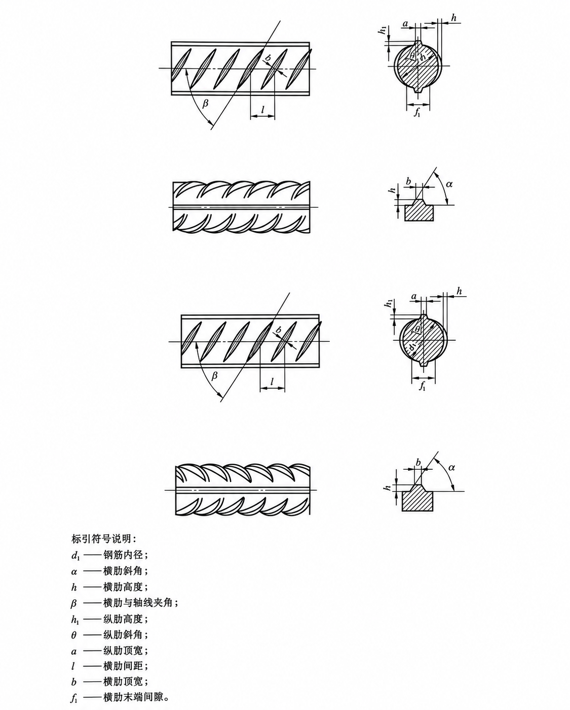

# HKRS Comparison Images

Public figure and standard-PDF assets for the HKRS Comparison website. The application source remains in the separate private `lawrence8880/hkrs-comparison` repository. This repository contains only media files and asset documentation.

## Upload an image directly in GitHub

1. Open [the quotes folder](https://github.com/lawrence8880/hkrs-comparison-images/tree/main/quotes).
2. Select **Add file → Upload files**.
3. Drag in your PNG, JPG or WebP image and select **Commit changes** on the `main` branch.
4. Insert an image tag in the relevant `.quotes.ts` file in the application repository.

Keep filenames exact, including capitalization and extensions. Prefer names without spaces, for example `GB1499.2-2024_Fig.1.png`. Use `_en` for a figure with English labels. Images must be in `quotes/` on `main`, not in the application repository's `client/public` folder.

## Paste-ready quote code

Paste an HTML image tag **inside** the backticks of an existing `zh`, `en`, `hkrsBody` or `quote` string. Do not overwrite the existing quotation text.

Chinese figure:

```html

```

English figure:

```html

```

The website's rich quote renderer also supports this shorter form:

```html

```

`/quote-images/` is a virtual prefix resolved by the application, not a folder served by the application. Use the full `raw.githubusercontent.com` URL for any other website or document. Do not copy the normal GitHub `.../blob/main/...` viewer URL as an image source.

## Updates and caching

For a new figure, upload the file here, then edit and sync/publish the application's `.quotes.ts` record. Uploading a new file alone does not add a quote entry. Replacing an already-referenced file at the same path does not require a new app build, but GitHub/browser caching may delay the update. For an immediate change, use a new filename or append a version query such as `?v=2` in the quote image URL and sync/publish the quote edit.

## Privacy and rights

Every image and PDF in this repository is publicly accessible. Do not upload personal, confidential, or restricted material. Upload only documents and figures you are authorized to publish. No license to the source standards is granted by this repository.

`manifest.json` records the initial migrated files and checksums. You do not need to edit it to upload future figures.

## Standard PDFs

Upload mapped PDFs to [standards/](https://github.com/lawrence8880/hkrs-comparison-images/tree/main/standards), not quotes/. Follow the folder's README and exact filenames in the private application inventory. Chinese standards open their published GitHub Pages PDF directly in the native browser reader in a new tab; official HK standard links remain on their original source sites, including CS1:2010's separate volumes. New files at existing mapped paths need no app rebuild, but wait for **pages build and deployment** to finish; new names or filenames require an app mapping update. Native viewing versus automatic download depends on browser settings. Original PDF bytes and independent quotes remain unchanged.

## GitHub Pages publication

The public media site publishes `main` → `/(root)`. Its `.nojekyll` marker prevents content transformation. PDF paths are `https://lawrence8880.github.io/hkrs-comparison-images/standards/<exact-filename>.pdf`. Only public media and its documentation are published; no private app code or clause data is copied here. Existing quote-image paths remain unchanged. Preserve `index.html` and `.nojekyll` when uploading media.
